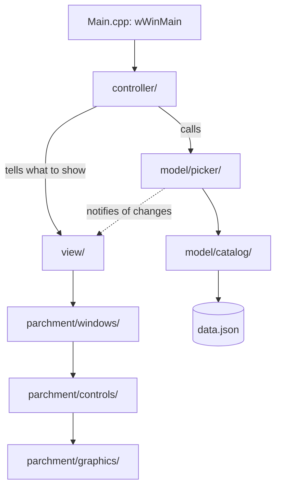

# Fresh Random Civ Picker: maintainer's guide

1. [Add a civ or a DLC](#add-a-civ-or-a-dlc)
2. [How the code works](#how-the-code-works)
   - [Files and folders](#files-and-folders)
   - [Diagram](#diagram)
   - [Building and running](#building-and-running)
   - [Startup](#startup)
   - [Model, view and controller](#model-view-and-controller)
   - [data.json and the catalog](#datajson-and-the-catalog)
   - [The folders of code, one by one](#the-folders-of-code-one-by-one)
   - [Tests](#tests)
   - [Rules for changing the code](#rules-for-changing-the-code)

## Add a civ or a DLC

When the game gets a new DLC, the program gets it through `data.json` and a few files named after the new civs. No
code, resource or project file changes (Rules 97 and 98).

You need: Windows 10 or later, Git Bash (it comes with Git for Windows), MinGW-w64 with `g++` and `windres` on the
`PATH`, the web version's `data.json`, and for each new civ an icon (PNG) and a jingle (WAV), for a new DLC its icon
(PNG). It takes about half an hour. The example adds the DLC "The Viking Sagas" with the civ "Danes".

1. **Bring `data.json` up to date.** `Fresh-Random-Civ-Picker_CPPGUI/data.json` must be identical to the web
   version's `data.json` (Rule 97), so copy that file over this one. If the web version does not have the DLC yet,
   make the same change in both files:
   - under `"dlcs"`, a line for the DLC. `name`, `edition` (an edition's `id`) and `released` are needed; `icon` is
     needed for a DLC with a toggle; `short` is optional:

     ```
     "sagas": {"name": "The Viking Sagas", "short": "Viking Sagas", "edition": "DE", "icon": "sagas",
               "released": "2026-09-22"}
     ```
   - in that edition's `"dlcToggles"`, the DLC's key, at the top of the list, as in
     `"dlcToggles": ["sagas", "chieftains", ...]`. Only the first nine toggles of an edition have a hotkey, so the
     oldest one loses its hotkey.
   - under `"civs"`, a line for each civ: `{"id": 13, "name": "Danes", "dlc": "sagas"}`. The ids run from 0 without
     gaps, each used once, and are the same as in the web version's file, since share links carry them. A name is
     one word without spaces, of at most 40 characters, and not "Random". Add `"techTree": "Incas"` only where
     aoe2techtree.net calls the civ something else.
2. **Add each civ's icon** as `Fresh-Random-Civ-Picker_CPPGUI/images/civ/<name in lower case>.png`, such as
   `images/civ/danes.png`. Any size works: the program fits it into its place.
3. **Add the DLC's icon** as `Fresh-Random-Civ-Picker_CPPGUI/images/dlc/<icon>.png`, where `<icon>` is the DLC's
   `icon` in `data.json`, such as `images/dlc/sagas.png`.
   Steps 2 and 3 can be done by a script when the web version already has the icons. It needs Python with Pillow
   (`pip install pillow`) and never replaces an icon that is already there:
   `python Fresh-Random-Civ-Picker_CPPGUI/tools/convert_web_assets.py <folder of the web version>`
4. **Add each civ's jingle** as `Fresh-Random-Civ-Picker_CPPGUI/sounds/civ_jingles/<name in lower case>.wav`, such as
   `sounds/civ_jingles/danes.wav`. If the civ's edition has `"legacyJingles": true` in `data.json`, also add the
   original game's jingle under the same name in `sounds/civ_jingles/legacy/`.
5. **Build the program.** In a Command Prompt or PowerShell, in the project's folder, run
   `Fresh-Random-Civ-Picker_CPPGUI\tools\build.bat`. It ends with `Built bin\FRCP_GUI.exe`, and has copied
   `data.json`, the images and the jingles beside the exe.
6. **Run the tests.** In Git Bash: `bash UnitTesting_FRCP/run-tests.sh`. The last lines say `[  PASSED  ]` and the
   number of tests. The tests read the real `data.json`, so a `FAILED` test here most likely points at the file: read
   the test's name and its message, and correct `data.json`.
7. **Try it.** Start `bin\FRCP_GUI.exe`. On the Civ Pool tab the DLC has a toggle with its icon, and the civ a
   toggle with its icon. Draw until the new civ comes up: its icon shows and its jingle plays.

   | Message at startup | What to do |
   | --- | --- |
   | `data.json: ...`, and the program does not start | The message says what is wrong, such as `civ 57 names an unknown DLC "saga"` or `the file is not valid JSON (line 60)`. Correct `data.json` and build again. |
   | `data.json could not be read from ...` | The file is not beside the exe. Build again with `build.bat`, which copies it. |
   | `The image ... could not be loaded from ...` | The named picture is missing or misnamed in `images/`. The program runs, with an empty place for it. |
   | `... civ jingles could not be loaded from ...` | A jingle is missing or misnamed in `sounds/civ_jingles/`. The program runs, silent for that civ. |

8. **Give the civ its history text**, if you have it: a UTF-8 text file `Histories\<Name>.txt` beside the exe, named
   as `data.json` names the civ, such as `Histories\Danes.txt`. Without it the History dialog says "History not
   found." for that civ. The `Histories` folder is not kept in the repository and no build copies it, so it must be
   put beside the exe, and into a release, by hand.
9. **Record the change** in the development log (`documentation/DEVLOG/`), and let a human commit it.

**If `data.json` is refused for holding too much:** the program has room for 64 civs, 128 DLCs, 3 editions and 4
links an edition, named in `common/CivDataLimits.h`. `MAX_DLCS` can simply be raised. `MAX_CIVS` and `MAX_EDITIONS`
cannot: a share link has one character for a civ (64 values), the civ grid has 13 rows of five, and the window has
room for three edition rows. Raising them is a change of the code and of the share link format, to be decided by the
chief developer together with the web version.

## How the code works

Fresh Random Civ Picker is a Windows program in C++ on the Win32 API. It draws everything itself with Direct2D,
DirectWrite and WIC, so that it looks like the web version at frcp.net. The code is in three parts (model, view and
controller) and a set of drawing components called Parchment. Everything about editions, DLCs and civs is read from
`data.json` at startup. The code has no comments (Rule 10): what a comment would have said is in this chapter.

### Files and folders

| File or folder | What it holds |
| --- | --- |
| `Fresh-Random-Civ-Picker_CPPGUI.sln` | The Visual Studio solution: the program's project and the test project. |
| `Fresh-Random-Civ-Picker_CPPGUI/` | The program. Directly in it: `Main.cpp` (`wWinMain`), `data.json`, `FRCP_GUI.rc` and `Resource.h` (icons, sounds of the interface, accelerators and their IDs), `targetver.h`, and the project file with its filters file. |
| `Fresh-Random-Civ-Picker_CPPGUI/tools/` | `build.bat` (builds with MinGW-w64 into `bin/`), `FRCP_GUI.manifest` (asks Windows for Common Controls 6, which the program needs to start), `convert_web_assets.py` (copies the web version's pictures as PNG). |
| `Fresh-Random-Civ-Picker_CPPGUI/images/` | Asset folder. `civ/` an icon for each civ and `random.png`; `dlc/` the DLCs' icons and each edition's icon (with `_hover` and `_pressed`) and banner; `ui/` the parchment, buttons, cursors, slider and frames. `civ_icons/`, `dlc_icons/` and `edition_icons/` hold older BMP files that the code no longer reads. |
| `Fresh-Random-Civ-Picker_CPPGUI/sounds/` | Asset folder. The interface's sounds, built into the exe through `FRCP_GUI.rc`, and `civ_jingles/` with a jingle for each civ, `random.wav`, and `legacy/` with the original game's jingles. |
| `.../common/` | What every part uses: `c_assert` (`Assertions.h`), the limits (`CivDataLimits.h`), the version and other constants (`GlobalConstants.h`), the Windows headers (`framework.h`). |
| `.../model/catalog/` | `JsonReader` reads JSON; `CivCatalog` reads and checks `data.json`. |
| `.../model/picker/` | `CivPickerModel` (the pool, the draws, the settings, the saved log), `HotkeyBindings` (which key each hotkey has), `ShareLink` (writing and reading share links). |
| `.../controller/` | `CivPickerController`: startup, the message loop, and what each command, hotkey and dialog result means. |
| `.../view/main/` | `CivPickerView`: the main window, its tabs, sounds and jingles, and what it shows when the model changes. |
| `.../view/dialogs/` | The dialogs: Options, Hotkeys, Customise Hotkeys, About, Join Lobby, History, Share and the links' dialogs. |
| `.../view/layout/` | Where every control of the main window goes, the DLC toggles' lists, the icon files' names, the tooltips. |
| `.../parchment/graphics/drawing/` | `ParchmentRenderer` (the only code that talks to Direct2D), `ParchmentFonts`, `ParchmentTheme.h` (images, colours, sizes), `PixelSurface`. |
| `.../parchment/graphics/layout/` | `ParchmentGeometry` (layout and pixel arithmetic in plain C++, tested), `ParchmentImages` (loads the pictures, builds the atlases and cursors). |
| `.../parchment/controls/base/` | `ParchmentControl`, the base of every control, and the buttons, labels, tabs, checkboxes and toggles. |
| `.../parchment/controls/lists/` | The text log, the scrollbar, the slider, and the look of dropdowns and text fields. |
| `.../parchment/windows/dialogs/` | `ParchmentDialogs` (builds a dialog from its layout) and `ParchmentShell` (a window's shape, skin and dimming). |
| `.../parchment/windows/popups/` | The menu bar, the tooltip and the toast (the short status message below the window). |
| `UnitTesting_FRCP/` | The tests: `run-tests.sh`, the Visual Studio test project, `TestMain.cpp`, `TestData.h` (reads the real `data.json`), and the test files in `tests/`. |
| `bin/`, `temp/` | Made by `build.bat` and `run-tests.sh`. Git leaves them out. |
| `documentation/` | This guide, `RULES.md`, `REQUIREMENTS.md`, `TESTS.md`, `DECISIONS.md`, `TERMINOLOGY.md`, and the development log in `DEVLOG/`. |
| `README.md` | Introduces the project. |
| `LICENSE` | The terms under which anyone may use the project. |
| `AGENTS.md` | What an AI agent must know before it changes anything here: what to read first, what it must never do, and when a change is done. |
| `CLAUDE.md` | The same for Claude Code, which reads this file by itself. It loads `AGENTS.md` and `RULES.md`. |
| `.claude/skills/` | Step-by-step procedures for AI agents, one folder each, such as how to write the development log. `ub-mode` is copied from another project and keeps its licence beside it. |
| `.claude/settings.json` | Stops Claude Code from committing and from changing `REQUIREMENTS.md`. |
| `.github/` | What GitHub shows contributors: how to contribute, report a bug or a security hole, the pull request form, the funding link, and the accessibility checklist. |
| `.github/workflows/checks.yml` | Tells GitHub to run the checks and the tests on a Windows machine on every push and pull request. |
| `.github/scripts/check-rules.sh` | Checks the rules a script can check; see [Tests](#tests). |
| `.gitattributes`, `.gitignore` | How Git treats line endings, and which files it leaves out. |

### Diagram



Every part may use `common/`. The view hands the user's input to the controller and reads the model, but never
changes it. Rule 102 says which folder may include from which.

### Building and running

- **With MinGW-w64:** `Fresh-Random-Civ-Picker_CPPGUI\tools\build.bat` builds `bin\FRCP_GUI.exe` as C++17 and copies
  `data.json`, `images\` and `sounds\civ_jingles\` beside it. It compiles every `.cpp` file of the folders it lists
  in `FOLDERS`, so a new file needs nothing, and a new folder goes into that list.
- **With Visual Studio:** open `Fresh-Random-Civ-Picker_CPPGUI.sln` and build. The project file copies the same data
  beside the exe. The test project needs its GoogleTest NuGet package restored first (right-click the solution,
  "Restore NuGet Packages"). A new source file must be listed in the project file and its filters file, and a new
  folder also among the include directories (Rule 103).
- **The program finds its files beside the exe**, whatever folder it is started from: `data.json`, `images\`,
  `sounds\civ_jingles\` and `Histories\`. It writes `settings.ini` and `log.txt` there. A release is a zip of the exe
  with these folders and `data.json`.
- **`build.bat` and the resource script.** Visual Studio saves `FRCP_GUI.rc` as UTF-16, which `windres` cannot read,
  so `build.bat` makes a UTF-8 copy in `bin\` and adds the manifest to it.
- **Text outside ASCII in the code** is written as `\u` escapes: without a byte order mark, MSVC reads a source file
  in the system's code page.
- Windows 10 version 1607 or later is needed, for the cursors' per-monitor DPI awareness.

### Startup

Startup is everything in `wWinMain` before the message loop starts (Rule 34). In order:

1. `CivPickerController::LoadCatalog` reads `data.json` into the `CivCatalog`. If the file is missing or wrong, a
   message says why and the program ends.
2. The model is made from the catalog, the controller from the model, and the controller makes its view. All three
   are static objects in `wWinMain`: nothing is a global, and nothing lives on the heap.
3. `CivPickerController::Run` works out the file paths, loads the sounds and jingles and the settings, starts the
   graphics (every image, font, atlas and cursor is built now), and creates the main window with all its controls.
4. `OnMainWindowCreated` sets the default edition (the first in `data.json`), loads the saved log if the user asked
   for that, registers the hotkeys and makes the startup draw.

After startup the program allocates no memory (Rule 35). That is why controls, dialogs and surfaces come from pools
of a fixed size, why texts go into fixed buffers (a text too long is cut short), and why every dialog's windows are
created when it opens from objects that already exist. The one exception is the clipboard, which demands a memory
block it then owns.

### Model, view and controller

- **The model** (`model/`) holds the data and every rule: which civs are in the pool, which were drawn, the
  settings. It is plain C++ without Windows, which is why the tests can run it.
- **The view** (`view/` with `parchment/`) owns every window, picture, font and sound. It only reads the model.
- **The controller** (`controller/`) gets the user's input from the view, decides what it means and calls the model.

Example, a click on Draw: the button sends `WM_COMMAND` to the main window; the view passes the command to
`CivPickerController::OnCommand`; the controller calls `CivPickerModel::DrawCiv`; the model picks a civ and tells its
observer, the view, through `CivPickerObserver::OnCivDrawn`; the view reads the drawn civ from the model and shows
its picture and name. The view knows how to change the display, the controller decides when.

In the tests the model has no view: a silent observer stands in (Rule 96).

### data.json and the catalog

`data.json` has three parts: `editions` (a list, the first being the default edition), `dlcs` (an object, each DLC
under its key) and `civs` (a list). They refer to each other by key and id:

```
"editions": [ {"id": "DE", "icon": "de", "banner": "de_wide", "dlcToggles": ["sagas"], "olderDlcs": ["aok"], ...} ]
"dlcs":     { "sagas": {"name": "The Viking Sagas", "edition": "DE", "icon": "sagas", "released": "2026-09-22"} }
"civs":     [ {"id": 13, "name": "Danes", "dlc": "sagas"} ]
```

- An edition's `dlcToggles` are the DLCs with a toggle on its Civ Pool tab, top to bottom, placed by
  `dlcToggleLayout`; a list that does not fit above the civ grid scrolls. `olderDlcs` are the DLCs of older editions
  that auto-toggle switches on with it. `links` are its entries in the Game menu. An edition needs a `url` (its
  store page) or a `storeNote`.
- An edition has its own civs and those of every older edition, by `year`.
- `CivCatalog::Load` checks all of it once: every reference resolves, a DLC has at most one toggle, a DLC with a
  toggle has an icon, civ names are unique. A civ's name is one word because the saved log parts a name from its
  state with a space, and "Random" is the program's name for "no civ drawn yet".
- File names follow from the data: a civ's icon and jingle are its name in lower case; an edition's pictures are
  `<icon>.png`, `<icon>_hover.png`, `<icon>_pressed.png` and `<banner>.png` in `images/dlc/`.
- A civ's id is what a share link and a saved log carry, and the order of the civ atlas; the Civ Pool tab and the
  History list show the civs in the order of their names instead.

### The folders of code, one by one

**`common/`.** `c_assert(x)` checks something that should never happen. Unlike `assert` it never stops the program and
it stays in Release builds: when the check fails it writes the file, line and expression to the debugger's output
and gives `false`, and the function recovers, as in `if (!c_assert(index < MAX_CIVS)) return false;`.

**`model/catalog/`.** `JsonDocument::Parse` splits the text into one token for each value, in one loop with an
explicit stack, so there is no recursion. An object's members are its key and value tokens in turn: a member's value
is the token after its key. `DataReader` (in `CivCatalog.cpp`) remembers only the first problem and where it was
found; after it every read gives an empty value, so reading runs on to the end and `Load` reports that first problem.
The DLCs are read first, since editions and civs refer to them.

**`model/picker/`.**
- *Draws.* `drawn_civs` holds the round's draws and, after an undraw, the ones that can be redrawn.
- *Continuous freshness* keeps the civs drawn last out of the next draws: as many as the setting says, at most half
  the pool. The top of the Options slider means "the most" and is saved as `CONTFRESH_MOST`, so it follows the
  pool's size. An old `settings.ini` with a strength from 1 to 10 is turned into a number of civs once, when the
  controller loads the settings.
- *Saving.* A save that cannot be written is skipped silently; the next one tries again. The edition is saved by its
  `id` in `data.json`.
- *Share links* (`ShareLink`) are the web version's, so a link made by either opens in the other: the web address,
  `#p=`, then a code of base64url characters: the format's version (`1`), the edition by its place in `data.json`,
  the pool as a bitfield of six civs a character (bit b of character c is the civ with id 6c + b), and optionally
  `.` and the round's draws, one character each. Civs past the end of a link's bitfield count as enabled, so civs
  added after a link was made are on when it is opened.
- *Hotkeys* (`HotkeyBindings`). A hotkey works on every tab or on one. A keystroke means at most one thing on each
  tab, so two hotkeys of different tabs may share it. Keystrokes are numbered as Windows numbers them for
  `RegisterHotKey`. Keys that cannot be hotkeys: punctuation (it depends on the keyboard's layout), F12 (Windows
  keeps it for debuggers), and the keystrokes Windows answers itself, such as Alt+Tab. The edition hotkeys and the
  nine DLC slot hotkeys (`DLC_HOTKEY_COUNT`) act by place in `data.json`; those with nothing to do there are unused.

**`controller/`.**
- *Draws are capped at 10 a second* (`MAX_DRAWS_PER_SECOND`). Each draw starts its jingle as a new asynchronous
  sound, and Windows frees interrupted ones only slowly: holding Space piled up about 1 MB a draw.
- *Hotkeys* are registered with `RegisterHotKey` while the main window is active, each under its action's number.
  A keystroke another program has taken stays without its hotkey. While the Customise Hotkeys dialog is open, the
  program's hotkeys are unregistered, so a keystroke that cannot be registered then belongs to another program.
- *`settings.ini`* has a `[Hotkeys]` line only for a hotkey whose key the user changed; the section is written anew
  at each save.
- *Auto-reset* resets before every command that changes the pool, by click or by hotkey.
- *A link or a saved log that is loaded* replaces the pool and the round; a link's draws come in without jingles.

**`view/`.**
- *The main window is the parchment itself*: a borderless window of a fixed size, with the title, the menu bar and
  the close button drawn on it. It moves by its title row and can be minimized, not resized. The parchment picture
  is never stretched: the window takes its height from it.
- *Reaching the object.* Windows delivers messages only through a plain function, so each window procedure finds
  its object in the window's user data (`GWLP_USERDATA`, or `DWLP_USER` for a dialog) and only passes the call on.
- *No `SendMessage` to its own window* (Rule 44): a handler calls the other handler directly or uses `PostMessage`.
- *Control IDs from data.* Civ toggles, DLC toggles, edition rows and Game menu links have IDs counted from a base
  plus their number in `data.json` (`CivPickerViewTypes.h`).
- *Jingles are mapped into memory*, not read: like a resource of the exe, a mapped file takes memory only while it
  plays. A sound that failed to load is never played, since playing it would only stop the sound that plays.
- *Idle memory.* After a few seconds without input (`IDLE_TRIM_DELAY_MS`) the program hands its unused memory back
  to Windows; whatever the next paint needs comes back at once.
- *Cursors.* The program is DPI-unaware, so Windows tells it 96 DPI everywhere. To learn a display's real DPI, and
  to make cursors Windows will not enlarge, the thread switches to per-monitor awareness for that one call. From
  150 % scaling on, the 48 px cursors are used.
- *Dialog layouts* (`DialogMetrics.h` and the files of `view/dialogs/`) are measured from text at startup; the
  Hotkeys dialog's again whenever a key changes. An error line makes its dialog grow.
- *Tooltips* end with their hotkey's present key; a DLC toggle after the ninth has no hotkey line.

**`parchment/graphics/`.**
- *The web version's CSS is the specification.* `ParchmentTheme.h` holds its colours, sizes and fonts, and
  `ParchmentGeometry` reproduces its layout rules (text wrap, nine-slice frames, the dotted focus outline, shadows,
  filters) in plain C++ so that they are tested. To change a look, find the rule in the web version's `style.css`.
- *`ParchmentRenderer` is the only code that talks to Direct2D, DirectWrite and WIC.* It draws into device contexts
  with two render targets: an opaque one for windows, with ClearType text, and one with premultiplied alpha for
  layered windows.
- *Images* are PNG files and not the web version's WebP, since Windows cannot be relied on to decode WebP. All are
  decoded at startup. The atlases (one image holding every civ's icon, one for the DLCs' and editions' icons) are
  built then from one file each, each icon fitted into its cell with its proportions kept, with a grey twin for
  disabled civs and DLCs. A file that cannot be loaded leaves its place empty and is counted; the first is named in
  a message. The program never fails for a missing picture.
- *Fonts.* Georgia for text; for the wooden buttons the first installed of Lucida Blackletter and Old English Text
  MT. Text is measured from glyph advances and kerning, which needs no memory at run time.

**`parchment/controls/`.**
- *A Parchment control is a child window that paints itself over its parent's backdrop.* Towards its parent it
  behaves like a Win32 button: a click sends `WM_COMMAND` with `BN_CLICKED`, and `BM_GETCHECK`, `BM_SETCHECK` and
  `BM_CLICK` work. Each kind of control is a `final` class derived from `ParchmentControl`.
- *The tab order of a dialog is the order in which its controls are created.*
- *Painting in batches.* Starting a frame costs about as much as drawing a control, so the first control to paint
  draws every sibling waiting for its paint in the same frame, through one shared back buffer.
- *A notification is posted, not sent*, where the parent then changes the control that notified it.
- *Dropdowns and text fields are the standard `COMBOBOX` and `EDIT`*, which already behave as users expect; they
  are subclassed only to look right. `ParchmentLog` replaces a read-only multi-line `EDIT`: its text is the window
  text, and it wraps, scrolls, selects and copies. The slider answers like a trackbar (`TBM_SETRANGE`,
  `TBM_SETPOS`, `TBM_GETPOS`, `WM_HSCROLL`).
- *A key button of the Customise Hotkeys dialog*, while listening, takes every key, also Tab, Enter and Esc, which
  a dialog would otherwise use itself. Backspace leaves the hotkey without a key.

**`parchment/windows/`.**
- *The shape of a window* (`ParchmentShell`). The window itself covers only the fully opaque pixels of its picture
  (a window region). A layered window it owns, the skin, lies over it and shows what is translucent: the burnt
  edge, a dialog's corners, the shadow. Clicks pass through the skin. Another layered window dims the whole shape
  while a dialog is open over it. All content lies on an opaque underlay and so belongs to the window, not the
  skin, because the skin follows a moved window a moment late.
- *Painting order.* Windows paints a window before its controls; the shell paints the controls first, so that a
  window and its controls change on the screen together.
- *Dialogs* (`ParchmentDialogs`) are ordinary modal dialogs whose procedures keep their job; the class builds the
  dialog from a layout (parts, which are controls, and decorations, which are drawn once) on `WM_INITDIALOG`.
  Dialogs can open over each other up to `MAX_LEVELS` deep. The close button is created last, so a dialog opens
  with its first part focused.
- *The menu bar* replaces the window's menu and keeps its keyboard use: Alt with a letter or F10 opens a menu. Its
  keys are taken in the message loop before the window sees them. A chosen item is posted as `WM_COMMAND`.
- *The tooltip and the toast* are one layered window each, made at startup.

### Tests

Run the tests with `bash UnitTesting_FRCP/run-tests.sh`, in Git Bash, with MinGW-w64's `g++` on the `PATH`. On its
first run it fetches GoogleTest 1.14.0 into the `temp/` folder, which Git leaves out; then it builds the tests and
runs them. GitHub runs the same on every push and pull request; a green tick in the repository's **Actions** tab
means they all passed. The Visual Studio test project `UnitTesting_FRCP` lists the same test files.

The tests cover what is plain C++: the model and `ParchmentGeometry`. Each test file includes the sources it tests.

| Test file in `UnitTesting_FRCP/tests/` | What it tests |
| --- | --- |
| `test.cpp` | `CivPickerModel`: draws, editions, sharing the pool, continuous freshness. |
| `CivDataTest.cpp` | `JsonDocument` and `CivCatalog`, with the real `data.json`. |
| `ShareLinkTest.cpp` | Share links as the web version writes and opens them. |
| `HotkeyBindingsTest.cpp` | The hotkeys' default keys, changing them, and their names in `settings.ini`. |
| `ParchmentGeometryTest.cpp` | The layout and pixel arithmetic; each test names the CSS rule it reproduces. |

The tests use the real `data.json` (Rule 82), so they hold for whatever it lists and name no civ themselves. A file
with a problem is made by `ProgramDataFileWith` in `TestData.h`: `data.json` with one text replaced. A new test file
goes into `run-tests.sh` and into the test project.

`TESTS.md` is where each test is listed by number. When you add, change or remove a test, update `TESTS.md`.

GitHub also runs `.github/scripts/check-rules.sh`, which checks what a script can check without knowing the language of
the code: that no folder holds too many files, that no two files share a name, that no line or file of code is too long,
that the development log keeps its form, and that `TESTS.md` numbers its tests 1, 2, 3 and so on. Run it yourself before
you commit, from the project's folder:

```
bash .github/scripts/check-rules.sh
```

On Windows, run it in Git Bash. Each line says `ok`, `skip`, `todo` or `FAIL`, and every `FAIL` names the file and the
rule. A `todo` does not fail: it lists the placeholders, names in double braces, still to fill in from the template.

Most of accessibility cannot be tested. `.github/ACCESSIBILITY.md` lists every success criterion of WCAG 2.2 AA; those
marked **human verification required** you check yourself, by using the interface as the item says, whenever a change
touches what the item is about. Mark each `[x]` when it holds.

AI agents have a procedure called `ub-mode`, which runs three tools that are not part of the project: crapper, which
scores each function by how complex it is and how much of it the tests run; dryer, which finds code written twice;
and mutator, which changes the code on purpose to see whether a test notices. `AGENTS.md` lists the languages they
work for. C++ is not among them, so for this project's code `ub-mode` is used only when asked for, and a tool that
does not work for C++ is skipped and named as not done. To try them, clone them once next to the project's folder,
in Git Bash; they need Python 3.11 or newer:

```
cd ..
git clone https://github.com/cnordenb/crapper
git clone https://github.com/cnordenb/dryer
git clone https://github.com/cnordenb/mutator
```

The first run of each sets itself up. What they write in the project, `.metrics/` and `target/`, Git leaves out.

### Rules for changing the code

`RULES.md` has the full list; the tests and `check-rules.sh` check part of it. Rules 0 to 26 are about the project as
a whole. Rules 27 to 105 are the project's coding rules (safety, names, functions, formatting, classes, error
handling, design, the model, view and controller, data and code, files and folders): read them before changing code.

- No file over 400 lines of code, no function over 60, and no line over 120 characters.
- No folder over 7 files, except `documentation/DEVLOG/` and the asset folders; the main folder may hold 8.
- No two files with the same name, except `SKILL.md` and files in the asset folders.
- No comments in the code. Explain what needs explaining in this guide instead.
- No edition, DLC or civ is named in code, resources, project files or tests: they are in `data.json` only.
- No memory is allocated after startup, nothing throws, and every loop has a fixed upper bound.
- The model includes nothing of Windows, the view never changes the model, the controller holds no rules.
- `REQUIREMENTS.md` defines what the project does, and only the chief developer may change it.
- Record what you change, and why, in the last part of `documentation/DEVLOG/`, under the day's date, and list any
  decision in `DECISIONS.md`.
- Only humans commit. AI agents leave their work for a human to read, test and commit.
